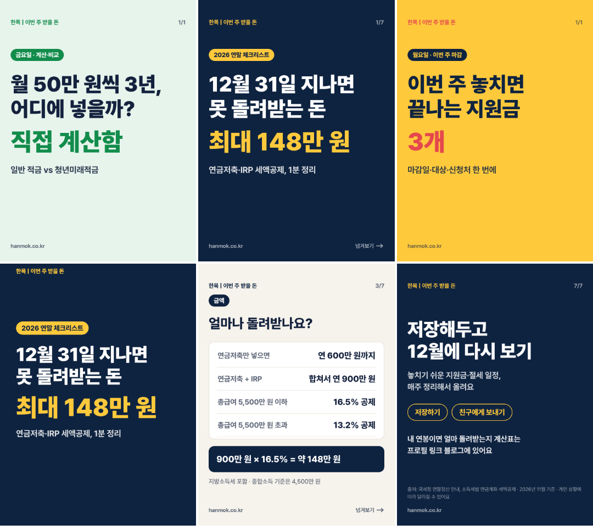

# 12. 인스타 썸네일·릴스 가이드

[← README](README.md) · [← 11 인스타 성장 전략](11_인스타그램_성장_전략.md) · [생성기 사용법](instagram/README.md)

- **기준일:** 2026-11-23
- **만든 것:**
  - 시리즈별 썸네일 색 체계
  - **릴스 자동 생성기** (카드뉴스 내용 그대로 9:16 영상)
  - 프로필 격자 미리보기 도구
  - 샘플 결과물



---

## 1. 참고 계정에서 가져온 패턴

> **조사 한계:** 인스타는 로그인 없이 볼 수 없고 이 환경에서는 접속도 막혀 있습니다. 그래서 공개 자료와 [11 문서](11_인스타그램_성장_전략.md)의 계정 분석을 바탕으로 정리했습니다. 참고하고 싶은 계정의 **프로필 격자와 릴스 화면을 캡처해 보내주시면** 이미지로 직접 분석해 템플릿을 맞춰 드립니다.

| 참고 대상 | 썸네일·릴스에서 가져올 것 |
|---|---|
| 청년정책사용설명서 (민간 정책 정리) | 정책 이름보다 **"누가, 얼마"**가 먼저 보이는 제목. 무료 자료로 연결 |
| 전주 청정지대 (지자체) | "1분 분량" 간편 카드뉴스. **항상 같은 순서**(대상 → 금액 → 기간 → 방법) |
| 케이뱅크 (금융 브랜드) | 2030 말투, 공감형 첫 문장 ("월급날만 기다리는 사람?") |
| 재테크 상황극 릴스 계정 | 첫 3초 안에 상황을 던지고 정보를 푸는 구조. 연기 대신 **내 목소리 + 자막**으로 대체 |
| 정보성 계정 공통 | ① 첫 장에 큰 숫자 하나 ② 시리즈마다 고정 색·고정 라벨 ③ 마지막 장에서 저장·공유 유도 ④ 릴스는 30초 이하, 첫 2초에 숫자 |

---

## 2. 썸네일(첫 장) 설계

### 2-1. 시리즈별 색 (격자에서 한눈에 구분)

| 시리즈 | 요일 | 색 | post.json의 `series` 값 |
|---|---|---|---|
| **이번 주 마감** | 월 | 노랑 배경 + 빨강 강조 | `"deadline"` |
| **제도 끝장 정리** | 수 | 남색 배경 + 노랑 강조 | `"deep"` (기본값) |
| **계산·비교** | 금 | 연두 배경 + 초록 강조 | `"calc"` |

> 노랑 → 남색 → 연두가 반복되면 프로필에 들어온 사람이 **"이 계정은 정리가 잘 돼 있다"**고 느낍니다. 정보성 계정이 팔로우를 받는 가장 큰 이유입니다.

### 2-2. 첫 장 문구 규칙

1. **한 장에 메시지 하나.** 제목은 2줄, 한 줄에 10자 안팎
2. **큰 숫자 하나:** 금액, 개수, 날짜 ("최대 148만 원", "3개", "12월 31일")
3. **손해·마감 표현이 이득 표현보다 강합니다:** "못 돌려받는 돈" > "돌려받는 돈"
4. **작은 칩(라벨)에 시리즈 이름:** "월요일 · 이번 주 마감"
5. 과장 금지: "무조건", "누구나", "100%"는 쓰지 않습니다. 정책 정보는 신뢰가 전부입니다.

### 2-3. 크기와 잘림

| 용도 | 크기 | 주의 |
|---|---|---|
| 카드뉴스 기본 | 1080×1350 (4:5) | 프로필 격자(3:4)에서 좌우가 약간 잘림. 여백 88px라 안전 |
| 카드뉴스 격자 꽉 채우기 | 1080×1440 (3:4) | post.json에 `"size": "3:4"` |
| 릴스 커버 | 1080×1920 (9:16) | 격자에서는 **위아래 약 240px씩 잘림**. 핵심 문구는 세로 300~1620px 안에 (생성기가 맞춰 둠) |

---

## 3. 릴스 포맷 5가지 (폰 1인 운영용)

| 포맷 | 길이 | 만드는 법 | 언제 |
|---|---|---|---|
| **① 카드 넘김형** ⭐ | 20~25초 | **생성기로 자동 생성** (카드뉴스와 같은 내용) | 매주 토요일, 수요일 카드뉴스를 영상으로 |
| ② 숫자 한 방 | 5~7초 | 표지 장면만 잘라 반복 재생되게 | 마감 임박 알림 (반복 재생 → 시청 완료율 ↑) |
| ③ 내 목소리 요약 | 30초 | ①번 영상 + 인스타·CapCut에서 내 목소리 녹음 | 반응 좋았던 주제 다시 쓸 때 |
| ④ 화면 녹화형 | 20~40초 | 폰으로 홈택스·신청 사이트를 화면 녹화 + 자막 | "신청 3번 누르면 끝" 같은 방법 설명. 진짜라는 신뢰가 큼 |
| ⑤ 댓글 답변형 | 15~20초 | 받은 질문 댓글 캡처 + 답 카드 | 질문이 쌓이면 |

**릴스 공통 규칙**
- **첫 2초에 숫자나 마감일.** 인사나 로고로 시작하지 않습니다.
- 장면당 글자는 한 번에 읽을 만큼만. 생성기는 장면당 2.6~3.8초로 맞춰 둠
- 음악은 **인스타 앱에서 직접** 넣습니다. 앱 음원은 사용 허가가 되어 있고, 인기 음원은 노출에도 도움이 됩니다. 음량은 낮게 해서 정보 전달을 방해하지 않게 합니다.
- **화면 위 220px, 아래 440px, 오른쪽 150px**에는 인스타 버튼과 캡션이 덮이므로 글자를 넣지 않습니다(생성기가 피해서 배치).

---

## 4. 폰으로 릴스 올리는 순서 (약 5분)

1. 대화로 받은 `reel.mp4`와 `reel-cover.png`를 **사진첩에 저장**
2. 인스타 → **＋ → 릴스** → `reel.mp4` 선택
3. **음악 추가**: 차분한 인기 음원을 고르고 음량을 낮춤
4. 다음 → **커버 수정 → 사진첩에서 추가** → `reel-cover.png` → **프로필 미리보기**에서 가운데로 맞춤
5. 캡션은 카드뉴스 `caption.md` 내용을 쓰고, 첫 줄만 "30초 정리"로 바꿈
6. **피드에도 공유** 켜기 → **고급 설정 → 예약** (토요일 오전 10시 또는 저녁 8시)

---

## 5. 생성기 사용법 (Claude에게 맡기면 자동)

```bash
# 카드뉴스 (시리즈 색은 post.json의 series 값으로)
node instagram/generator/render.mjs instagram/posts/<폴더>

# 같은 내용으로 릴스 영상 + 커버
node instagram/generator/reel.mjs instagram/posts/<폴더>

# 프로필 격자 미리보기 (이미지 여러 장을 3열로)
node instagram/generator/grid-preview.mjs 결과.png 이미지1.png 이미지2.png ...
```

- 결과물:
  - `slide-01~07.png`: 카드뉴스
  - `reel.mp4`: 1080×1920, 30fps, H.264, 무음 오디오 트랙 포함, 약 24초
  - `reel-cover.png`: 릴스 커버
- 영상에 소리는 넣지 않았습니다. 음악은 앱에서 넣는 게 저작권과 노출 면에서 모두 유리합니다.

---

## 6. 주간 흐름에 넣기

| 요일 | 게시 | 만드는 것 |
|---|---|---|
| 월 | 카드뉴스 (노랑, 이번 주 마감) | 일요일에 Claude에게 요청 → 예약 |
| 수 | 카드뉴스 (남색, 끝장 정리) | 같은 요청에서 함께 생성 |
| 금 | 카드뉴스 (연두, 계산·비교) | 같은 요청에서 함께 생성 |
| **토** | **릴스** (수요일 내용을 영상으로) | **자동 생성**. 음악만 앱에서 추가 |
| 매일 | 스토리 | 릴스를 스토리에 공유하고, 마감 D-day 스티커 |

**매주 일요일 요청 예시**
> "이번 주 인스타 세트 만들어줘. 월: 이번 주 마감 지원금, 수: ○○ 끝장 정리, 금: ○○ 비교. 수요일 건은 릴스도."

→ 카드뉴스 3세트, 릴스 1개, 커버, 캡션, 격자 미리보기까지 한 번에 받습니다.

---

### 출처
- 릴스 커버 안전영역·피드 미리보기 영역: https://www.openads.co.kr/content/contentDetail?contsId=20232 , https://www.somake.ai/ko/blog/instagram-reel-size-guide
- 프로필 격자 3:4 변경, 피드 비율 범위: https://carat.im/b2b/blog/instagram-feed-size , https://www.linearity.io/blog/instagram-size-guide/
- 인스타 사이즈 가이드: https://blog.highoutputclub.com/2024-insta-size-guide/
- 재테크 릴스 첫 3초·저장 유도: https://www.stocktok.kr/2026/06/2026-100-1_01790443549.html
- 참고 계정 근거는 [11 문서](11_인스타그램_성장_전략.md)의 출처 참고
